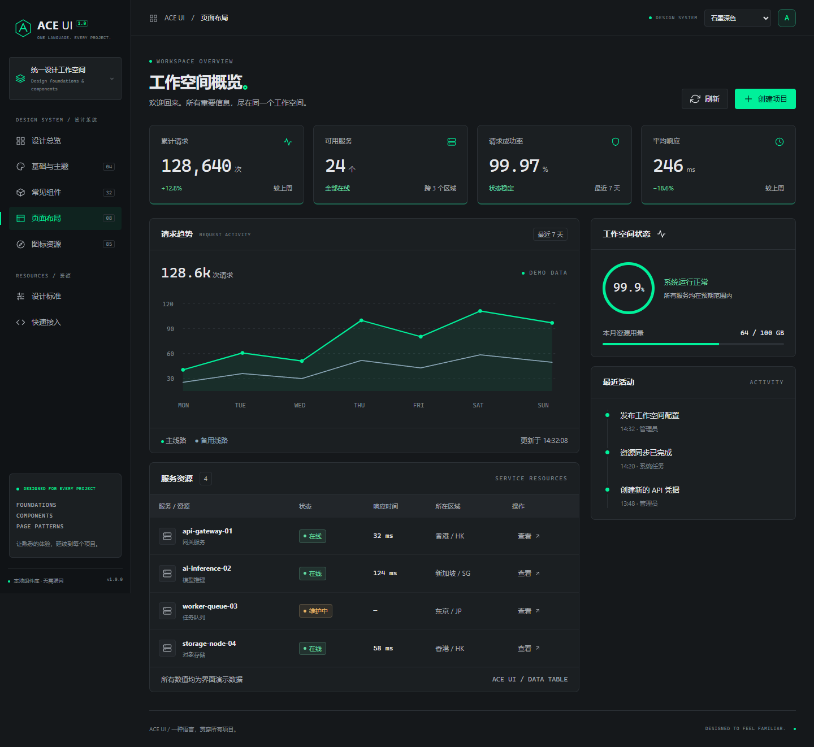
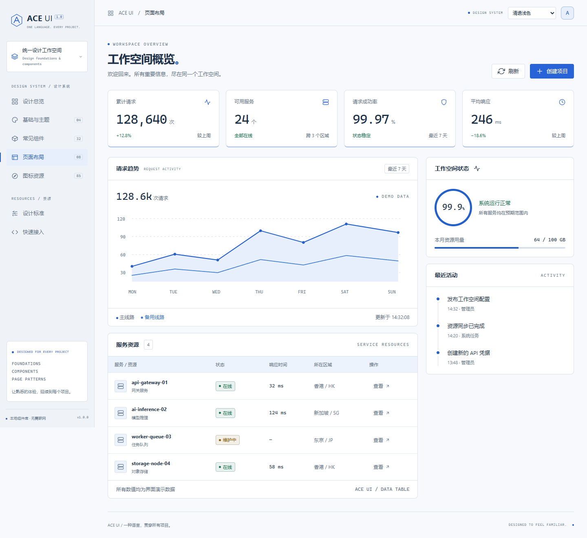
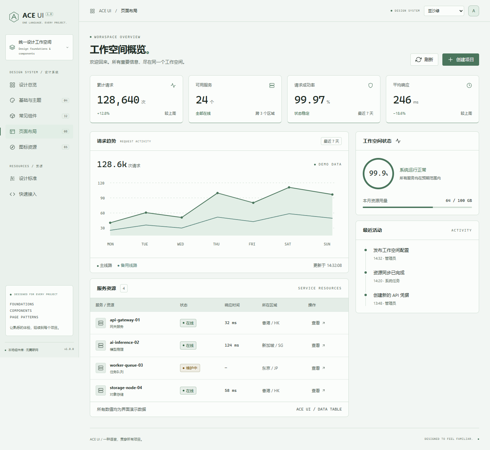
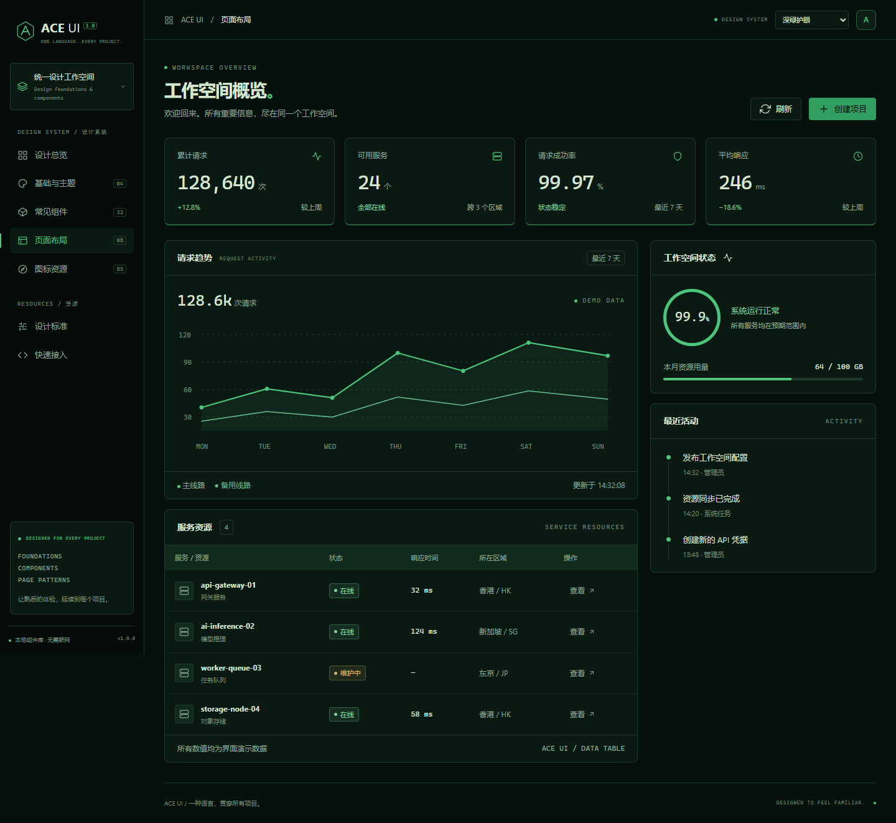

# ACE UI · Design System and Component Library

[简体中文](README.md) · English

ACE UI is a lightweight, framework-agnostic design system for building consistent web, Windows-style, and mobile interfaces. Graphite Dark is the default theme. All four palettes share the same layouts, type scale, components, and interactions.

The library includes **32 component examples, 12 page templates, and 85 SVG icons**, along with reusable CSS, design tokens, and integration examples for plain HTML, Vue 3, and React.

## Preview

Clone or download the repository and open [index.html](index.html) in a browser. The showcase runs offline without a build step or runtime dependencies. To serve it over HTTP with Node.js, run:

```sh
node preview.mjs
```

Open `http://127.0.0.1:8095` on the same machine. On Windows, you can also double-click [启动预览.cmd](启动预览.cmd). Each of the [12 templates](templates/) can be opened independently. The showcase and demo interfaces are written in Simplified Chinese.

## Windows and mobile app examples

| Example | Windows window | Mobile app |
| --- | --- | --- |
| AI Assistant | [Template](templates/windows-assistant.html) · [Screenshot](docs/screenshots/windows-assistant.png) | [Template](templates/mobile-assistant.html) · [Screenshot](docs/screenshots/mobile-assistant.png) |
| Management Workbench | [Template](templates/windows-workbench.html) · [Screenshot](docs/screenshots/windows-workbench.png) | [Template](templates/mobile-workbench.html) · [Screenshot](docs/screenshots/mobile-workbench.png) |

The AI Assistant includes conversation history, prompt templates, model selection, and sample replies. The Management Workbench includes a dashboard, task creation and filtering, status updates, and an activity log. Both use browser-local demo data. Windows title-bar controls preview window states in the browser. Desktop applications can connect those controls to their window host, and mobile projects can reuse the layouts in a browser or WebView.

## Themes and screenshots

| Graphite Dark · `dark` (default) | Daylight · `light` |
| --- | --- |
|  |  |
| **Sage · `sage`** | **Forest · `eye`** |
|  |  |

[Component gallery](docs/screenshots/components.png) · [Mobile workspace](docs/screenshots/mobile.png)

## Quick start

Copy [css/](css/) and the optional [js/](js/) directory into your project, keeping their internal paths. Use [dist/ace-ui.css](dist/ace-ui.css) if you prefer a single stylesheet for the core library.

```html
<!doctype html>
<html lang="en" data-ace-theme="dark">
<head>
  <meta charset="utf-8">
  <meta name="viewport" content="width=device-width, initial-scale=1">
  <title>ACE UI Example</title>
  <script src="js/ace-theme-init.js"></script>
  <link rel="stylesheet" href="css/ace-ui.css">
  <script defer src="js/ace-icons.js"></script>
  <script defer src="js/ace-ui.js"></script>
</head>
<body class="ace-ui">
  <button class="ace-btn ace-btn--primary" data-ace-toast="Project created">
    <span data-ace-icon="plus"></span>Create project
  </button>
</body>
</html>
```

ACE UI uses `ace-` classes and `--ace-` CSS variables. Base styles apply within the `.ace-ui` root. Load `ace-theme-init.js` before the stylesheet to restore the saved theme before the first render. With the optional interaction scripts loaded, call `AceUI.setTheme('sage')` to switch themes. In Vue or React, you can import the CSS and icons directly and manage interaction state in your framework.

To reuse an app template, load [css/ace-app.css](css/ace-app.css) after the core stylesheet and keep the shared and app-specific scripts referenced by the template. The [app template guide](docs/双端APP模板.md) provides integration details in Chinese.

## Included resources

| Resource | Purpose |
| --- | --- |
| [css/ace-ui.css](css/ace-ui.css) | Main import for tokens, base styles, components, layouts, and utilities |
| [css/ace-tokens.css](css/ace-tokens.css) · [tokens/ace-tokens.json](tokens/ace-tokens.json) | Semantic colors, typography, spacing, and sizing in CSS and JSON |
| [css/ace-app.css](css/ace-app.css) | Window frames, fixed composer, bottom navigation, and mobile sheets |
| [js/](js/) | Optional theme, icon, toast, dialog, drawer, tab, and navigation behavior |
| [icons/svg/](icons/svg/) · [SVG sprite](icons/ace-sprite.svg) · [Icon JSON](icons/ace-icons.json) | Standalone icons, an SVG sprite for HTTP use, and icon paths for framework renderers |
| [templates/](templates/) | Eight general-purpose pages and four Windows and mobile app examples |
| [examples/](examples/) | Plain HTML, Vue 3, and React integration sources |
| [docs/](docs/) · [AI_PROMPT.md](AI_PROMPT.md) | Chinese design guidelines, component conventions, and project instructions |

The visual baseline uses graphite surfaces, mint accents, 1px borders, and a 4px spacing grid. Control, card, and dialog radii are 4px, 8px, and 12px. Desktop controls are available in 28px, 36px, and 44px heights. Primary touch targets use at least 44px.

## Checks and browser support

```sh
npm run check
```

The static check validates local assets, links, ARIA references, and theme constraints. With Playwright and Chromium available, run `node qa/browser.cjs` against the local preview server for showcase checks, or `node qa/apps.cjs` for the four app templates. Set `PLAYWRIGHT_MODULE` and `CHROME_PATH` if your local installations require explicit paths.

ACE UI targets modern browsers with CSS custom properties, `color-mix()`, native dialogs, and `:focus-visible`. Test embedded WebViews on your target devices.

## License

[Apache License 2.0](LICENSE)
