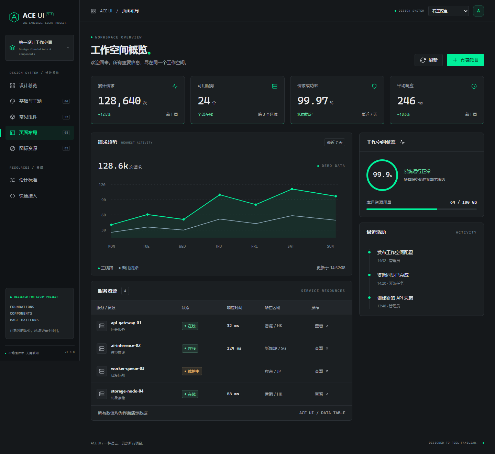
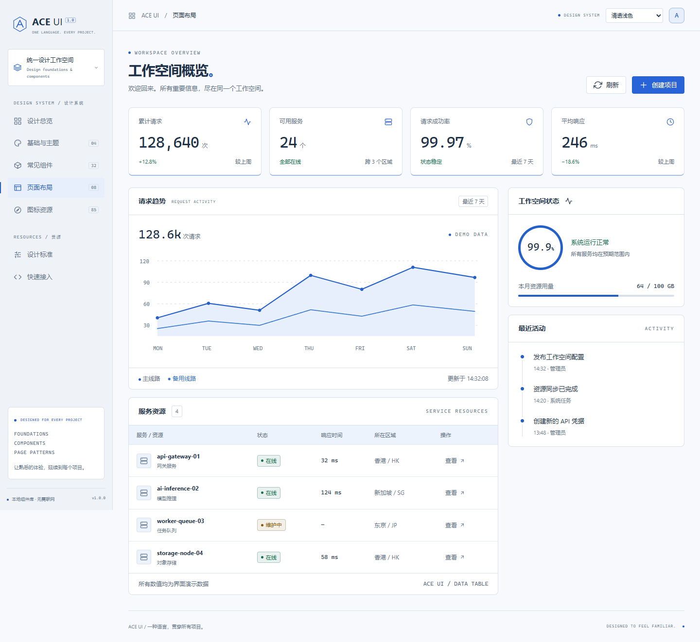
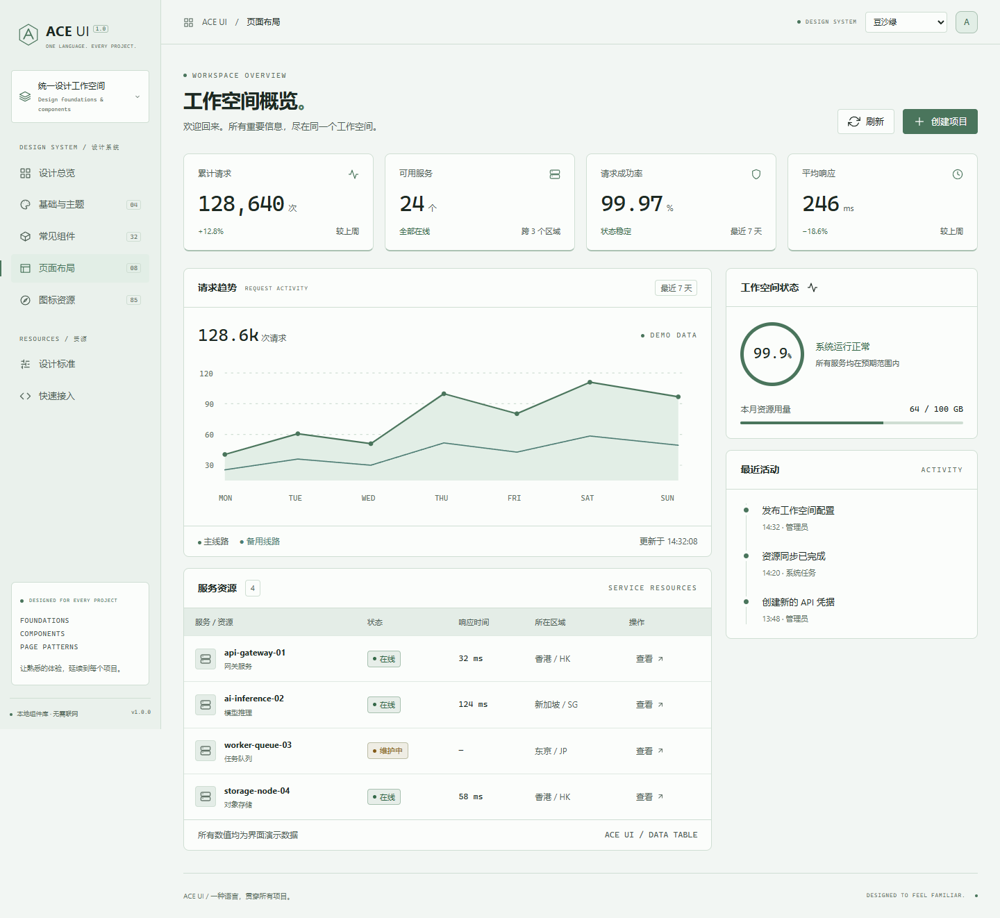
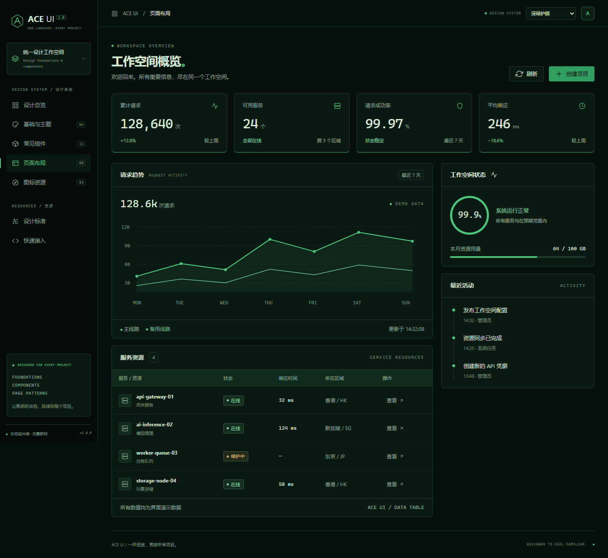
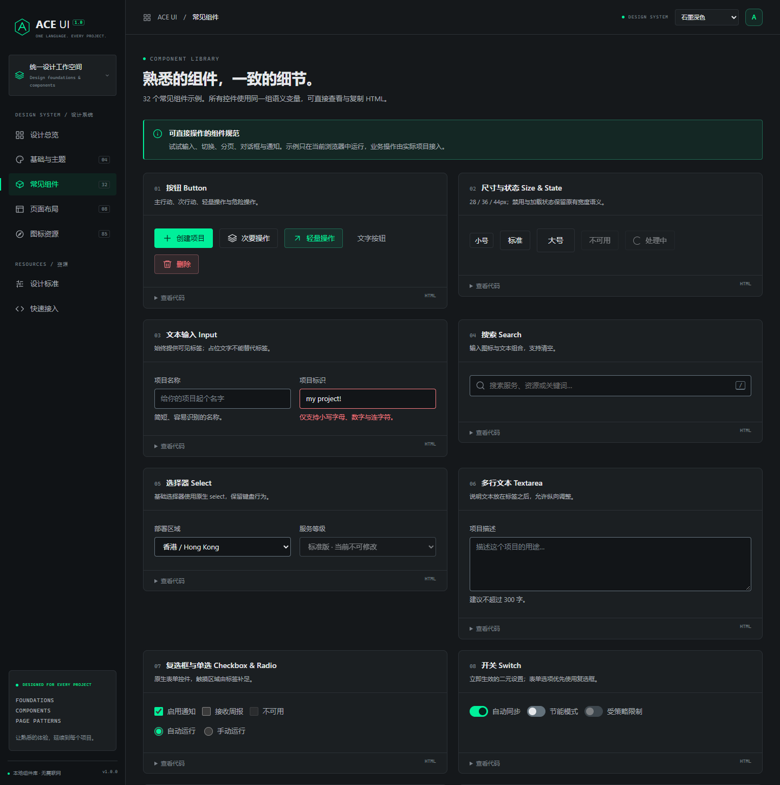
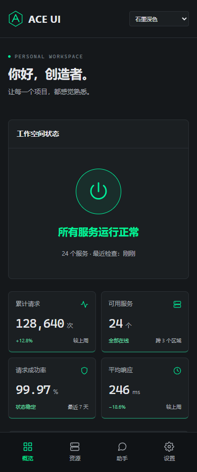

# ACE UI · 统一设计语言与组件库

让每个项目，都感觉熟悉。

ACE UI 是框架无关的轻量设计系统，默认石墨深色，提供四种配色、32 个常见组件、12 套页面模板和 85 个 SVG 图标。内含 Windows 与手机双端的 AI 助手、管理工作台案例，以及可直接使用的 CSS、中文规范和 Vue / React 接入示例。

## 双端 APP 案例

| 案例 | Windows 窗口 | 手机 APP |
| --- | --- | --- |
| AI 助手 | [窗口模板](templates/windows-assistant.html) · [截图](docs/screenshots/windows-assistant.png) | [手机模板](templates/mobile-assistant.html) · [截图](docs/screenshots/mobile-assistant.png) |
| 管理工作台 | [窗口模板](templates/windows-workbench.html) · [截图](docs/screenshots/windows-workbench.png) | [手机模板](templates/mobile-workbench.html) · [截图](docs/screenshots/mobile-workbench.png) |

AI 助手包含对话、历史、提示模板和模型选择。管理工作台包含概览、任务筛选与创建、状态更新和动态记录。四个模板都可从本地 `index.html#layouts` 打开，支持四种皮肤和本地演示数据。Windows 窗口控件在浏览器内预览窗口状态，手机模板适合在浏览器和 WebView 中复用。接入方式见 [双端 APP 模板](docs/双端APP模板.md)。

## 界面截图

四种皮肤共享同一套布局、组件与交互，只替换颜色。点击图片可查看原图。

| 石墨深色 · 默认皮肤 | 清透浅色 |
| --- | --- |
|  |  |
| **豆沙绿** | **深绿护眼** |
|  |  |

### 常见组件

按钮、表单、搜索、选择器、复选框与开关，保持统一的间距、边界和状态语言。



### 移动工作台

响应式卡片、触摸控件与底部导航，延续同一套设计语言。



## 预览

- 直接双击 `index.html`，无需联网、安装依赖或构建。
- 或在本目录执行 `node preview.mjs`，访问 `http://127.0.0.1:8095`。也可双击 `启动预览.cmd`。
- 目录 `templates/` 内 12 个页面可独立打开。四种皮肤会在当前浏览器中记忆。
- 所有业务数值、认证、聊天、上传与保存均为明确标注的本地交互示例；实际业务需接入 API。

## 包含什么

| 目录 | 用途 |
| --- | --- |
| `css/ace-ui.css` | 总入口，依次引入变量、基础、组件、布局与工具类 |
| `css/ace-tokens.css` | 四种皮肤 + 字号、间距、圆角、动效等共享变量 |
| `dist/ace-ui.css` | 已合并的单文件 CSS，复制这一份即可使用全部样式 |
| `css/ace-app.css` | APP 模板附加样式，提供窗口外框、固定输入区、底部导航和底部面板 |
| `js/` | 可选原生交互：主题、图标、Toast、Dialog、Drawer、Tabs、移动导航 |
| `tokens/ace-tokens.json` | 可读 JSON 颜色与几何规范，便于其他平台转译 |
| `icons/svg/` | 85 个独立 SVG 图标 |
| `icons/ace-sprite.svg` | HTTP 环境可用的 SVG sprite |
| `icons/ace-icons.json` | 图标路径数据，便于框架按需渲染 |
| `assets/ace-mark.svg` | ACE UI 标识，矢量源文件 |
| `templates/` | 8 个通用页面，以及 Windows 和手机双端的 AI 助手、管理工作台 |
| `examples/` | 最小 HTML、Vue 3 与 React 接入示例 |
| `docs/` | 中文设计语言、组件规范、主题接入、图标规则与来源说明 |
| `AI_PROMPT.md` | 可直接交给后续 AI 项目的统一 UI 指令 |
| `scripts/check.mjs` | 无依赖静态资源、链接与主题约束检查 |
| `qa/` | 浏览器回归脚本、实际检查记录与预览截图 |

## 快速接入

```html
<html lang="zh-CN" data-ace-theme="dark">
<head>
  <script src="js/ace-theme-init.js"></script>
  <link rel="stylesheet" href="css/ace-ui.css">
  <script defer src="js/ace-icons.js"></script>
  <script defer src="js/ace-ui.js"></script>
</head>
<body class="ace-ui">
  <button class="ace-btn ace-btn--primary" data-ace-toast="已创建">
    <span data-ace-icon="plus"></span>创建项目
  </button>
</body>
</html>
```

复制 `css/` 和可选的 `js/` 到项目内，或单独复制 `dist/ace-ui.css`。所有公开类名和变量均使用 `ace-` / `--ace-` 前缀；元素基础规则只作用于 `.ace-ui` 内。

新项目默认写 `data-ace-theme="dark"`。`ace-theme-init.js` 在 CSS 前加载，恢复用户主动选择的皮肤，防止首屏闪烁；不根据操作系统自动改变默认皮肤。不需要记忆时省略此脚本。

四种主题键：`dark`、`light`、`sage`、`eye`。原生交互脚本使用 `AceUI.setTheme('sage')`；框架项目优先由框架管理 DOM 与状态，CSS 和图标可单独使用，见 `examples/`。

## 设计基线

石墨灰表面、薄荷绿强调色、1px 细边、克制的小圆角、紧凑而清晰的控制台排布。4px 网格；控件 4px、卡片 8px、弹窗 12px；桌面控件 28 / 36 / 44px，触摸主控件至少 44px；侧栏 232px、顶栏 64px；正文 13–14px。

颜色、几何和交互统一由 ACE UI 规范管理。设计归一记录见 `docs/来源与提取.md`。

## 检查

```sh
npm run check
# 或 node scripts/check.mjs
```

浏览器回归需本机已有 Playwright 与 Chromium；无需为组件库安装依赖。设置 `PLAYWRIGHT_MODULE` 为模块路径，必要时设置 `CHROME_PATH`，再运行 `node qa/browser.cjs`。检查结果以 `qa/验证报告.md` 为准。

兼容目标为支持 CSS variables、color-mix、原生 dialog、:focus-visible 的现代 Chromium / Firefox / Safari；旧 WebView 需按目标环境实测。无 CDN、远程字体与第三方运行时依赖。

版本：1.0.0 · 2026-11-18
